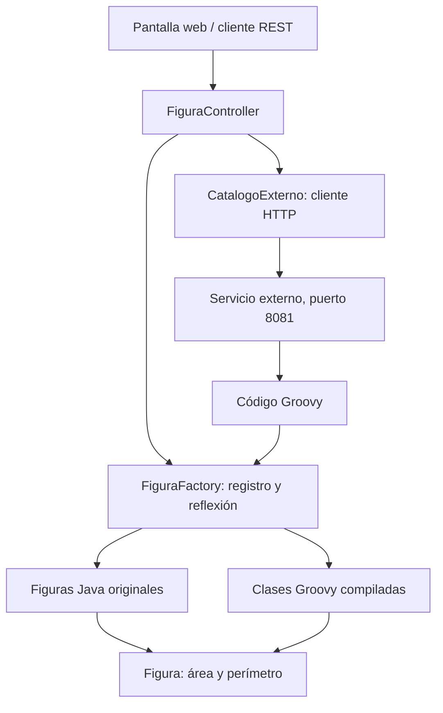

# Figuras dinámicas — Henry Olmedo

Aplicación Java 17 + Spring Boot 4.1.1 basada en el diseño del deber 1. Conserva la clase abstracta `Figura`, sus métodos `calcularArea()` y `calcularPerimetro()`, y las clases `Circulo`, `Cuadrado` y `Triangulo`.

## Requisitos y ejecución

- JDK 17 o superior.
- Python 3 para el servicio externo de demostración.
- Internet en la primera compilación para descargar Maven y las dependencias.

Desde la raíz del repositorio, abre dos terminales:

**Terminal 1 — servicio externo independiente:**

```bash
python catalogo-externo/servidor.py
```

En sistemas que lo requieran usa `python3` o `py`.

**Terminal 2 — aplicación Spring:**

```bash
cd Arquitectura_HenryOlmedo
```

Windows (PowerShell):

```powershell
.\mvnw.cmd spring-boot:run
```

Linux/macOS:

```bash
sh mvnw spring-boot:run
```

Abre http://127.0.0.1:8080. No se necesita base de datos.

## Cómo demostrar todos los puntos de la tarea

1. Selecciona **Circulo**, escribe `{"radio":5}` y pulsa **Calcular área y perímetro**. Resultado: área `78.53981633974483`, perímetro `31.41592653589793`.
2. Prueba las otras figuras originales. Cuadrado con lado 4: área 16 y perímetro 16. Triángulo con base 3, altura 4 y lados 3, 4 y 5: área 6 y perímetro 12.
3. En **Compilar código Groovy**, utiliza el ejemplo `Rectangulo` incluido en la pantalla. Pulsa **Compilar y registrar**. Sin reiniciar, selecciónalo y calcula con `{"base":6,"altura":3}`: área 18 y perímetro 18.
4. Con el servicio externo encendido, introduce `Pentagono` y pulsa **Descargar y registrar**. Se hace una petición HTTP al proceso del puerto 8081, se descarga el código, se compila y se registra.
5. Calcula `Pentagono` con `{"lado":5}`: área aproximada `43.011935`, perímetro 25. También puedes importar `Hexagono`.
6. Para demostrar que es extensible, agrega al directorio del catálogo otro archivo `.groovy` que cumpla el contrato, e impórtalo por su nombre. No se modifica ni se recompila la aplicación Java.

Las figuras registradas viven en memoria: se cargan de nuevo tras reiniciar. Un nombre repetido se rechaza para no reemplazar clases existentes silenciosamente.

## Arquitectura y reflexión



- `FiguraFactory` busca la clase por nombre en un registro. Para las clases Java obtiene el constructor y sus nombres de parámetros usando reflexión (`getConstructors`, `getParameters`) y crea el objeto con `newInstance`. Maven compila con `-parameters` para conservar los nombres reales.
- Para extensiones, `GroovyClassLoader.parseClass` compila y carga una clase en tiempo de ejecución. Se comprueba que extienda `Figura`, sea concreta y tenga constructor público con `Map`. Se instancia también por reflexión.
- El cálculo usa polimorfismo: Java y Groovy comparten los métodos de `Figura`.
- `CatalogoExterno` descarga el código mediante `HttpClient`, con tiempos de espera y manejo de errores. La URL es configurable mediante `FIGURAS_CATALOGO_URL`.
- Se usa **Groovy**, una de las dos alternativas permitidas por el enunciado. No hace falta implementar también Rhino.

## Contrato de una figura nueva

Archivo `Pentagono.groovy` (ejemplo completo en `catalogo-externo/figuras`):

```groovy
import com.example.arquitectura_henryolmedo.Figura
class MiFigura extends Figura {
    double lado
    MiFigura(Map parametros) {
        if (parametros.keySet() != ['lado'] as Set)
            throw new IllegalArgumentException('Se requiere lado')
        lado = parametros.lado
    }
    double calcularArea() { lado * lado }
    double calcularPerimetro() { 4 * lado }
}
```

El ejemplo ilustra el contrato; cada figura define sus propias fórmulas y valida sus parámetros específicos. La fábrica valida valores positivos y finitos. El triángulo conserva el contrato original de cinco parámetros: quien lo utiliza debe proporcionar base, altura y lados geométricamente consistentes.

## API

| Método | Ruta | Datos |
|---|---|---|
| GET | `/api/figuras` | Lista de nombres registrados |
| POST | `/api/figuras/calcular` | `{"clase":"Circulo","parametros":{"radio":5}}` |
| POST | `/api/figuras/groovy` | `{"codigo":"...código de la clase..."}` |
| POST | `/api/figuras/externas/Pentagono` | `{}` |

Las entradas inválidas producen HTTP 400. Los errores del catálogo producen HTTP 502.

## Pruebas

Desde `Arquitectura_HenryOlmedo`:

```bash
sh mvnw test
```

En PowerShell: `.\mvnw.cmd test`.

Las pruebas verifican fórmulas originales, cálculo REST, compilación Groovy, importación desde un servidor HTTP independiente iniciado por la prueba, errores de parámetros, clase inválida, fuente incorrecta, duplicados y figura externa inexistente. No requieren levantar manualmente el catálogo.

Para empaquetar:

```bash
sh mvnw package
java -jar target/Arquitectura_HenryOlmedo-0.0.1-SNAPSHOT.jar
```

## Alcance de la demostración

El catálogo Python es un **servicio externo a la aplicación Spring**, ejecutado en otro proceso y consumido por HTTP. No es una API pública de terceros. Puedes apuntar a otro catálogo que sirva archivos `.groovy` usando `FIGURAS_CATALOGO_URL` (URL base terminada en `/`).

La aplicación escucha solo en `127.0.0.1` y está pensada para la demostración local. Groovy ejecuta código real con permisos del proceso: utiliza únicamente fuentes propias o de confianza. El cargador no es una sandbox y esta aplicación no debe exponerse públicamente para recibir código anónimo.

El ZIP original del deber 1 se conserva como antecedente; para esta versión utiliza el código del repositorio actualizado.

Referencia técnica: https://groovy-lang.org/integrating.html (integración de Groovy mediante GroovyClassLoader).
